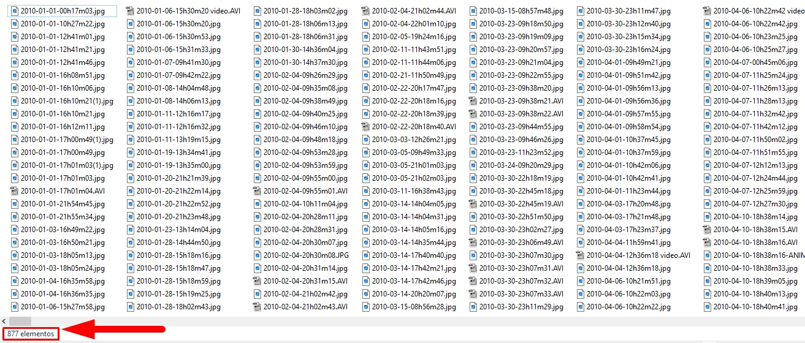
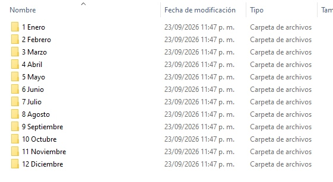
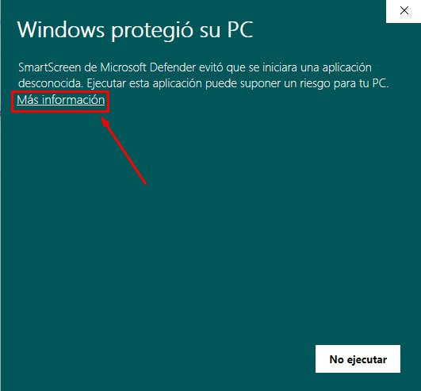
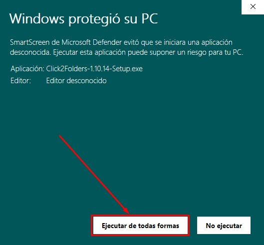
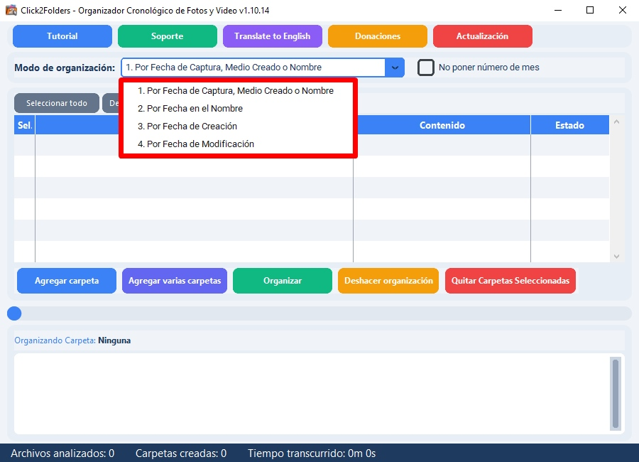
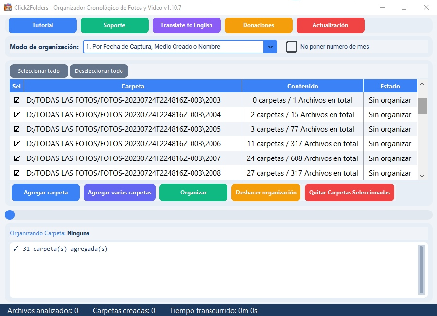
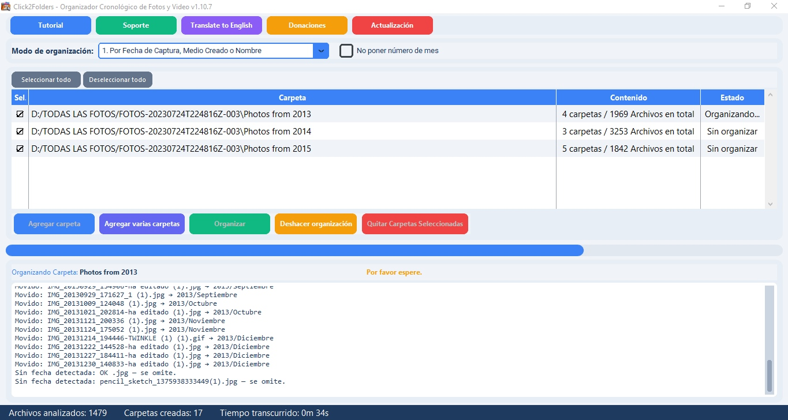
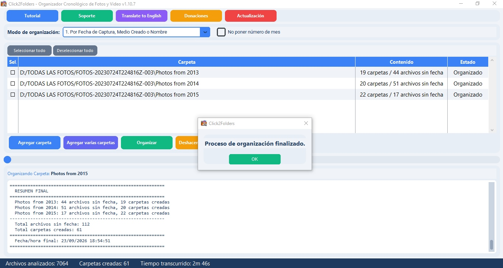
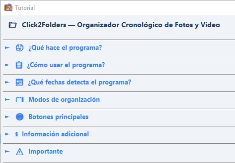
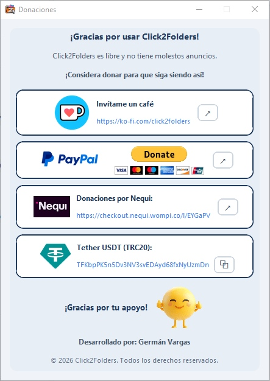

  

<h1 align="center">Click2Folders</h1>

  <b>Organizador Cronológico de Fotos y Videos</b> 
  <i>Chronological Photo & Video Organizer</i>

  
  
  
  
  

---

## ¿Qué hace el programa? / What does it do?

Click2Folders detecta las siguientes fechas de tus fotos y videos:
### 1) Fecha de captura / Medio creado o Nombre
### 2) Fecha en el nombre
### 3) Fecha de creación
### 4) Fecha de modificación
Puedes elegir cualquiera de los 4 fechas o modos con lo que el programa creara carpetas por año y subcarpetas por mes, luego mueve automáticamente tus archivos a su carpeta correspondiente ordenando todo de forma cronológica con un click, también puedes desorganizar las carpetas organizadas por el programa y volver a organizar tus archivos eligiendo una de fecha diferente.

Click2Folders detects the dates of your photos and videos to create year folders, month subfolders and then moves them to their corresponding folder automatically.

## Capturas / Screenshots

### Ejemplo de 877 archivos desordenados / Example of 877 unsorted files

  

### Ahora los puedes organizar en carpetas por años con un click/ Now you can organize them into folders by year with just one click

  

### ¡Y subcarpetas por mes! / And month subfolders!

  

### Tambien nombra las subcarpetas en inglés, solo pon el programa en inglés y da click en organize / It also names the subfolders in English; just set the program to English and click “Organize.”

  

### Instalación - SmartScreen / Installation - SmartScreen

  

  

### Tienes 4 modos de organización: 
### 1) Por fecha de captura / Medio creado o Nombre
### 2) Por fecha en el nombre
### 3) Por fecha de creación
### 4) Por fecha de modificación

  

### Carpetas Cargadas / Folders Loaded

  

### Organizando / Organizing

  

### Organizado / Organized

  

### Deshacer organización: mueve todos los archivos a la carpeta raiz y elimina las carpetas vacias de año y subcarpetas de mes creadas por el programa con el fin de poder elegir otro modo de organización/ Reset organization: Moves all files to the root folder and deletes the empty year folders and month subfolders created by the program so that you can choose a different organization method

  

### Desorganización completada / Disorganization Complete

  

### Aqui se organizaron las mismas carpetas en otro modo / Here, the same folders were organized differently.

  

### Tutorial de como funciona el programa

  

### El programa es gratuito, libre de anuncios y seguro, considera donar para apoyar al desarrollador / The program is free, ad-free, and secure; please consider making a donation to support the developer

  

## Características / Features

- **4 modos de organización:**

1. Por Fecha de Captura, Medio Creado o Nombre
2. Por Fecha en el Nombre del archivo
3. Por Fecha de Creación
4. Por Fecha de Modificación

- **Interfaz intuitiva** con diseño moderno
- **Soporte completo** de imágenes (JPEG, PNG, GIF, RAW, etc.) y videos (MP4, AVI, MOV, MKV, etc.)
- **Organización masiva** de múltiples carpetas a la vez
- **Deshacer organización** con un solo clic
- **Soporte bilingüe** (Español / Inglés)
- **Auto-check de actualizaciones** desde GitHub
- **Sin conexión a internet** - todo funciona localmente
- **No borra tus archivos** - solo los organiza
- **0/69 falsos positivos en VirusTotal** - seguro y limpio

## Seguridad / Security

El instalador de Click2Folders ha sido analizado en **VirusTotal** con resultado de **0 detecciones de 69 antivirus**. Esto garantiza que el programa es seguro para su uso.

The Click2Folders installer has been analyzed on **VirusTotal** with a result of **0 detections out of 69 antivirus engines**. This ensures the program is safe to use.

## Privacidad / Privacy

Click2Folders **no recopila datos de usuarios**: todo funciona localmente en tu PC.

Política completa: [PRIVACY.md](PRIVACY.md)

Click2Folders **collects no user data**: everything runs locally on your PC. Full policy: [PRIVACY.md](PRIVACY.md).

## Descarga / Download

Ve a la sección de [Releases](https://github.com/regerman78-ai/Click2Folders/releases) y descarga la última versión.

Go to the [Releases](https://github.com/regerman78-ai/Click2Folders/releases) section and download the latest version.

## Donaciones / Donations

Si el programa te es útil, considera hacer una donación para apoyar su desarrollo.

If the program is useful to you, consider making a donation to support its development.

### Ko-fi
Invítame un café / Buy me a coffee: **https://ko-fi.com/click2folders**

### PayPal

### Nequi (Colombia)
Donaciones por Nequi: **https://checkout.nequi.wompi.co/l/EYGaPV**

### Tether USDT (TRC20)
Dirección: `TFKbpPK5n5Dv3NV3svEDAyd68fxNyUzmDn`

## Información del Desarrollador / Developer Info

Desarrollado por: **Germán Vargas**

Correo de contacto: **click2folders@gmail.com**

## Requisitos del Sistema / System Requirements

- Windows 10 o superior
- 4 GB de RAM mínimo
- 100 MB de espacio en disco

## ¿Cómo usarlo? / How to use?

1. Descarga el instalador o usa la versión portable y abre el programa
2. Elige el modo de organización y agrega las carpetas que quieras
3. Click en Organizar

¡También puedes deshacer la organización y elegir otro modo de organización las veces que quieras!

---

  © 2026 Click2Folders - Todos los derechos reservados

